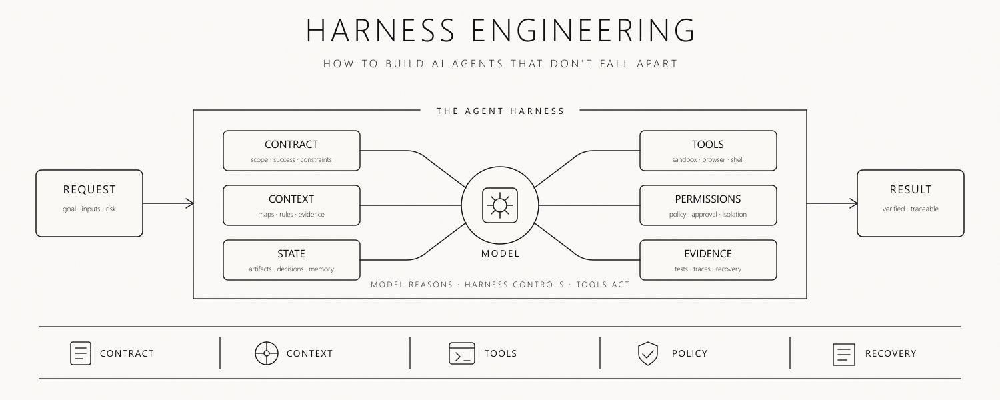

# Harness framework

`agents.jpeg` at the repository root is the source of this frame.

## The frame

REQUEST (goal · inputs · risk) → THE AGENT HARNESS → RESULT (verified · traceable).

Six pillars surround a MODEL. Given to the model: CONTRACT (scope · success ·
constraints), CONTEXT (maps · rules · evidence), STATE (artifacts · decisions ·
memory). Constraining the model: TOOLS (sandbox · browser · shell), PERMISSIONS
(policy · approval · isolation), EVIDENCE (tests · traces · recovery).

The frame's own caption: **MODEL REASONS · HARNESS CONTROLS · TOOLS ACT**.

The bottom band is the process order, and each band stage maps to one pillar:
CONTRACT → CONTRACT, CONTEXT → CONTEXT, TOOLS → TOOLS, POLICY → PERMISSIONS,
RECOVERY → EVIDENCE.

This frame compresses [SOFTWARE_FACTORY_BLUEPRINT_V2.txt](SOFTWARE_FACTORY_BLUEPRINT_V2.txt);
it does not replace it. The blueprint keeps the prescriptions, this file maps
them onto the code that exists. Verified outcomes stay in
[FACTORY_EXECUTION.md](FACTORY_EXECUTION.md).

## The pillar map

| Pillar | Blueprint V2 section(s) | Current implementation (file:line) | Verdict | Next increment |
| --- | --- | --- | --- | --- |
| CONTRACT | contract `docs/SOFTWARE_FACTORY_BLUEPRINT_V2.txt:139`, unit of work `docs/SOFTWARE_FACTORY_BLUEPRINT_V2.txt:168` | task validation `overseer/factory.py:351`; closed field sets per mode `overseer/factory.py:360`, `overseer/factory.py:367`, `overseer/factory.py:374`; unknown fields rejected `overseer/factory.py:382`; argument arrays only, no implicit shell `overseer/factory.py:389`; frozen spec hash `overseer/factory.py:473`; contract block validation `overseer/factory.py:222`; contract field set `overseer/factory.py:68`; routing-policy input map `overseer/factory.py:100`; contract in the inspect result `overseer/factory.py:538`; monitor report contract `overseer/policy.py:82`; prompt length bound `overseer/policy.py:63`; monitor request contract `config.json:1` | partial — the factory contract is closed, hashed, and immutable, and a command-mode spec carries a closed, validated contract block with a risk tier, external effects, protected paths, approval requirements, acceptance identifiers, the routing-policy required inputs, and a budget; the contract block is required for new command-mode submissions, validated, closed, and frozen with the specification hash at dispatch; a job stored before the requirement keeps its specification and stays dispatchable and inspectable, because the requirement is checked only at submit; the block's statements are recorded, never enforced: no budget limit, protected path, or approval requirement is acted on, the risk tier is a declaration, and there is no approver identity; the monitor's request contract is still one free-text string, so the contract gap in that system is unchanged; the routing policy's `required_decision_fields` have no code counterpart because no router exists | close the monitor-side request contract as its own increment; that gap is unchanged and separately filed, and the factory contract now covers the Risk and Budget groups while the blueprint's Identity, Dependency, Execution, Verification, and Result groups remain uncovered |
| CONTEXT | context across sessions `docs/SOFTWARE_FACTORY_BLUEPRINT_V2.txt:282`, the four memory kinds `docs/SOFTWARE_FACTORY_BLUEPRINT_V2.txt:288`, durable entry fields `docs/SOFTWARE_FACTORY_BLUEPRINT_V2.txt:297`, task inputs `docs/SOFTWARE_FACTORY_BLUEPRINT_V2.txt:180`, task result `docs/SOFTWARE_FACTORY_BLUEPRINT_V2.txt:186`, handoff record `docs/SOFTWARE_FACTORY_BLUEPRINT_V2.txt:299` | continuation instruction `config.json:1`; bounded report-field splicing `overseer/policy.py:189`; report contract restated `overseer/policy.py:64`; prompt assembly `overseer/policy.py:255`; step marker `overseer/policy.py:34`; finished-step report `overseer/policy.py:135`; stop decision `overseer/policy.py:172`; current turn `overseer/policy.py:40`; marker after a step report `overseer/policy.py:138`; handoff decision `overseer/policy.py:158`; writer-handoff prompt `overseer/policy.py:217`; handoff branch of the prompt decision `overseer/policy.py:275`; handoff eligibility `overseer/policy.py:304`; skill provenance `factory/skills-provenance.json:1`; provenance reader `overseer/skills.py:160`; provenance bounds `overseer/skills.py:19`; entry validation `overseer/skills.py:79`; installed-bytes check `overseer/skills.py:109`; repository provenance path `overseer/factory.py:26`; provenance read per attempt `overseer/factory.py:2121`; skills file in the run evidence `overseer/factory.py:2126`; skills environment `overseer/factory.py:1046`; manifest skills `overseer/factory.py:1259`, `overseer/factory.py:1316`; context manifest writer `overseer/factory.py:1061`; manifest written per completed attempt `overseer/factory.py:2230`; repository identity probe `overseer/factory.py:327`; memory table `overseer/factory.py:449`, `overseer/factory.py:1916`; memory record API `overseer/factory.py:824`, `overseer/factory.py:876`; memory in the inspect result `overseer/factory.py:540`; memory recall `overseer/factory.py:943`; recall environment `overseer/factory.py:1018`; recall file in the run evidence `overseer/factory.py:2099`; codebase file tree `overseer/codemap.py:115`; structure extraction `overseer/codemap.py:143`; codebase assembly `overseer/codemap.py:1058`; code excerpt `overseer/codemap.py:176`; secret names `overseer/codemap.py:166`; test file convention `overseer/codemap.py:278`; parsed references `overseer/codemap.py:289`; textual references `overseer/codemap.py:317`; relation search `overseer/codemap.py:376`; relation of a symbol `overseer/codemap.py:484`; relation digest `overseer/codemap.py:1160`; memory bounds `overseer/codemap.py:54`; memory attachment `overseer/codemap.py:693`; identifier-boundary match `overseer/codemap.py:606`; memory digest line `overseer/codemap.py:1262`; recall passed to the map `overseer/factory.py:2109`; codebase environment `overseer/factory.py:1029`; attached count in the environment `overseer/factory.py:1039`; widening bounds `overseer/codemap.py:61`; selection widening `overseer/codemap.py:904`; widening after the task's own selection `overseer/codemap.py:1101`; widened reason in the digest `overseer/codemap.py:1232`; selection line of the digest `overseer/codemap.py:1167`; widened count in the environment `overseer/factory.py:1041`; manifest widening `overseer/factory.py:1197`, `overseer/factory.py:1199`; relation counts in the supplied source `overseer/factory.py:1109`; manifest relations `overseer/factory.py:1201`; manifest memory attachment `overseer/factory.py:1225`; codebase file in the run evidence `overseer/factory.py:2111`; handoff command projection `overseer/handoff.py:44`; handoff record builder `overseer/handoff.py:187`; handoff.json written into the run evidence `overseer/factory.py:1410`; manifest handoff block `overseer/factory.py:1261`; handoff event `overseer/factory.py:1421` | partial — the factory now writes a context manifest into the run evidence directory of every completed attempt, recording the objective, the spec hash, the workspace, the repository identity and base commit when one was observed, the acceptance identifiers, the commands actually run, the environment facts the runner already holds, and a supplied list that says what was supplied and why; it stores the blueprint's four memory kinds, a verified fact, a decision, a hypothesis, and a historical attempt, in the ledger, queryable per job and per kind, durable across a backup and restore; a new attempt now recalls the relevant records of its own job and of earlier runs in the same project before it starts, marks the superseded decisions and the facts whose bound revision has moved as unusable, writes the recall into the run evidence, and hands it to the execution environment; it also assembles a codebase context from the workspace file tree, selects the files the task names or whose path matches the task terms, extracts the structural symbols of those files, and hands the map to the attempt; the map names files and symbols and carries a bounded excerpt of the code of those symbols, at most 8 KiB and 60 lines per file and 32 KiB for the whole attempt, and a file whose name marks it as a secret is never read for its content; the map also relates each selected symbol to the code that calls it and to the test files that cover it, and that relation is honest about what it is: Python is parsed and every other language is matched textually, so a relation is a static reference and not a proven call, an attribute reference does not name the object it belongs to, and a textual match may be a comment or a string; the search is capped at 400 files and 2 MiB with 20 callers and 10 tests per symbol, the size of a file is checked before it is opened so the bytes read never pass the bound, a symbol nothing references is recorded with the number of files that were searched, and a corpus the cap truncated is recorded as truncated with the reason that says so; the map also attaches each recalled memory record to the selected symbols and files it names, by a textual, case-sensitive match on identifier boundaries that does not prove a record is about the symbol: every name is matched in the record's affected component and only an identifier-shaped name in its entry, the most specific name wins, and a record that names a selected file's path but none of its symbols attaches to the file; every status attaches, and a superseded, invalidated, unverified, or historical record is marked not usable with the reason why, in the map, the digest, and the manifest; at most 5 records per symbol and 5 per file are kept with 160 characters of entry, 32 unattached records are listed, and the digest shows 6 memory lines per file; the counts describe the attachments the caps kept, and a record the caps dropped is counted apart; a record that names nothing selected stays in the recall and is counted as unattached with the reason; an attached decision is supplied to the attempt and not enforced; the selection is widened one round, by a current decision's textual path match in its affected component or entry and by a caller's static reference to a symbol of the task's own selection, at most 4 files, never past 12 and never displacing the task's own selection, and the task's own files spend the excerpt budget first; a decision that names a symbol but no path does not widen, a test file does not widen as a caller, a secret is never widened, and a verified fact, a superseded decision, a hypothesis, and a historical attempt never widen; every candidate the bounds left out is recorded with the reason of the bound that applied, and the counts describe the files in the selection; a file holding only callers past the cap of 20 of a caller list is not seen, and the selection says how many caller lists were cut; the monitor's prompts now carry the prompt-writer loop and the rule that a prompt's stopping condition ends that prompt, not the objective: a report of status step_done that names the next step gets a writer-handoff prompt, which tells the pane to give the step's results to the dedicated prompt-writing agent, have it write the next bounded prompt, and execute and verify it, instead of a stop, and an OVERSEER_DONE marker directly under such a report ends the step and not the objective; only a report of the current turn counts, so a step report of an earlier turn, or one quoted with prose after it, never overrides a stop, and the marker names in the prompts are quoted so that a wrapped echo of a sent prompt cannot start a line with one; a done report, a needs_input report, the OVERSEER_NEEDS_INPUT marker anywhere in the current turn, a permission or generation screen, a report with no remaining step, the idle threshold, the cooldown, the already-sent screen, and the daily limit still stop or hold it; the handoff is instructed and not verified; a hypothesis stays unverified, a historical attempt is preserved as a result and not as current state; the skill provenance file is read and validated at the start of every attempt, its skills are recorded as declared, their installed bytes are checked against the recorded hashes without leaving the installed directory or opening a secret, no skill is supplied to an attempt, and activation is not observed, so nothing records a skill as active; a missing or malformed file is recorded with its reason and does not block the attempt; every attempt that writes a context manifest now also leaves a handoff.json in its run evidence directory, carrying the blueprint's ten fields — the objective, the attempt-start base revision, the candidate revision when the attempt moved HEAD, the completed, failing, and not-run acceptance identifiers, the environment state, the commands actually run, the unresolved effects, the remaining budget, and the next eligible action — and every field the factory cannot observe is null with the reason that it could not be observed: the tokens and the cost are never estimated, the environment digest is never computed, the unresolved effects and the remaining budget are never derived from a declaration, and the repair allowance the contract declares is not the budget that remains; the three identifier lists are disjoint and cover the contract's identifiers, and an identifier whose command never ran is in neither the completed nor the failing list, because the run stops at the first failing command; the base revision is the commit observed at attempt start, before the implementation command, so the manifest's repository block and the record name the same observation and cannot disagree; the next eligible action is one of three closed values — product_review, bounded_repair, or controller_decided — and it says whether the factory or the successor decides it; the record is scoped to one attempt by its run directory and names its job_id, run_id, and spec_hash, and a later run leaves an earlier record byte-identical; the record is context: it never changes an attempt's outcome, nothing judges an attempt by it, and a write that fails is recorded with its reason and leaves the attempt as it was | read the persisted handoff record back and reconcile it against the ledger row and the workspace — the blueprint's "the successor checks the ledger and workspace before trusting the summary; if they disagree, reconcile" (`docs/SOFTWARE_FACTORY_BLUEPRINT_V2.txt:299`) is still done by hand, and no code reads handoff.json |
| STATE | durable state and recovery `docs/SOFTWARE_FACTORY_BLUEPRINT_V2.txt:192` | ledger schema `overseer/factory.py:410`, `overseer/factory.py:415`, `overseer/factory.py:424`, `overseer/factory.py:430`; immutable submission `overseer/factory.py:466`; run evidence directory `overseer/factory.py:2092`; memory records `overseer/factory.py:449`; monitor state file `overseer/__main__.py:19`; atomic save `overseer/__main__.py:23`; single-writer lock `overseer/__main__.py:265` | partial — artifacts and decisions are durable and survive restart; the memory kinds are stored in the ledger and a new attempt now recalls the relevant ones, of its own job and of earlier runs in the same project; monitor state holds hashes and timestamps only, never conversation text | keep the recalled records and the ledger they are read from in step |
| TOOLS | safe execution `docs/SOFTWARE_FACTORY_BLUEPRINT_V2.txt:244` | terminal transport `overseer/tmux.py:220`; pane inventory and exclusion `overseer/tmux.py:99`; read-only pane inspection `overseer/tmux.py:170`; client model picker driver `overseer/tmux.py:184`; driven clients `overseer/tmux.py:15`; client phase detection `overseer/scheduler.py:48`; OpenCode composer and running markers `overseer/modelchoice.py:280`, `overseer/modelchoice.py:293`; target scope `overseer/tmux.py:116`, `overseer/tmux.py:136`, scope-aware opt-in `overseer/tmux.py:145`; client directory `overseer/tmux.py:28`; session routing `overseer/route.py:62`; argument-vector command runner `overseer/factory.py:1447`; bubblewrap profile `overseer/isolation.py:98`; probe verdict `overseer/isolation.py:138`; probe entry `overseer/isolation.py:166` | partial — real but narrow; the bubblewrap profile probes a disposable runtime and is not a sandbox for the trusted argument-vector runner `overseer/factory.py:1`; Codex, Claude, and OpenCode sessions can be driven, a Grok session cannot because its composer is not recognized; the OpenCode turn states are recognized, so a finished turn releases the queue reservation; the transport manages only the panes that are enrolled or inside the configured target scope, and ignores every other tmux window; there is no file, git, network, or browser tool, and no provider adapter | keep the probe as recorded evidence; add any real tool surface only behind a proven boundary |
| PERMISSIONS | risk group `docs/SOFTWARE_FACTORY_BLUEPRINT_V2.txt:168`, envelope modes `docs/SOFTWARE_FACTORY_BLUEPRINT_V2.txt:543`, effect broker `docs/SOFTWARE_FACTORY_BLUEPRINT_V2.txt:230` | screen-text deny list `overseer/policy.py:19`; screen classification `overseer/policy.py:296`; rate and scope policy `overseer/policy.py:319`; opt-in enrollment `overseer/__main__.py:372`; exclusion list `overseer/__main__.py:362`; provider failure detection `overseer/modelchoice.py:85`; model decision pause `overseer/scheduler.py:236`; credit fallback policy `overseer/modelchoice.py:126`; zero-credit route `overseer/scheduler.py:148`; exhausted status `overseer/scheduler.py:256`; operator model choice `overseer/__main__.py:139`; isolation fails closed `overseer/isolation.py:166`; policy proposal `factory/routing-policy.json:3`; envelope field set `overseer/factory.py:88`; envelope modes `overseer/factory.py:89`; envelope validation `overseer/factory.py:276`; awaiting-approval submission `overseer/factory.py:466`; approvals table `overseer/factory.py:445`; decision record `overseer/factory.py:776`; dispatch gate `overseer/factory.py:2060`; decision in the inspect result `overseer/factory.py:542` | partial — policy, isolation, and one operator approval gate exist: a pane that reports an unsupported model, exhausted credits, or a failed login is paused, never retried, and never given a substituted model; exhausted credits route the work to the configured zero-credit tier, and when that tier is exhausted too the pane waits in `CREDITS_EXHAUSTED_WAITING` instead of downgrading; the factory now carries a recorded envelope: a command-mode task may name one of the blueprint's four modes, its declared scope, whether a fresh decision is required, and the decider it names, and a task that declares it needs a decision waits in `awaiting_approval` and is not dispatched until a decision is recorded in the ledger; the record names the decider, the decision, and the time; the mode, the scope, and the decider identity are recorded, never enforced — there is no roster check, no scope check, no policy engine, no operator pause of running work, and no retry-with-reason path; `factory/routing-policy.json:3` still states that no runtime code reads it and no router enforces its decisions | make the envelope mandatory for new command-mode submissions, and add the blueprint's remaining permission controls: an operator pause of running work and a retry-with-reason path |
| EVIDENCE | verification `docs/SOFTWARE_FACTORY_BLUEPRINT_V2.txt:303`, release gates `docs/SOFTWARE_FACTORY_BLUEPRINT_V2.txt:332`, bounded repair `docs/SOFTWARE_FACTORY_BLUEPRINT_V2.txt:350`, failure drills `docs/SOFTWARE_FACTORY_BLUEPRINT_V2.txt:616`, verification record `docs/SOFTWARE_FACTORY_BLUEPRINT_V2.txt:311` | controller-owned verifier identity `overseer/factory.py:49`, `overseer/factory.py:63`; verifiers `overseer/factory.py:131`, `overseer/factory.py:142`; publish gate `overseer/factory.py:1762`; reconcile `overseer/factory.py:740`; resolve with operator note `overseer/factory.py:760`; backup `overseer/factory.py:1875`; fenced restore `overseer/factory.py:2011`; workspace snapshot `overseer/workdiff.py:157`; patch capture `overseer/workdiff.py:340`; read-only git runner `overseer/workdiff.py:52`; changes made by the checks `overseer/workdiff.py:477`; capture bounds `overseer/workdiff.py:22`; snapshot before the implementation command `overseer/factory.py:2180`; capture after it `overseer/factory.py:2183`; diff.patch and diff.json in the run evidence `overseer/factory.py:1361`, `overseer/factory.py:1377`, `overseer/factory.py:1381`; capture guard `overseer/factory.py:1341`; manifest workspace diff `overseer/factory.py:1293`; candidate revision observed only when HEAD moved `overseer/factory.py:1099`, `overseer/handoff.py:66`; run summary `overseer/factory.py:2211`, `overseer/factory.py:2215`; continuous integration `.github/workflows/check.yml:22`; coverage `tests/test_factory.py:77`, `tests/test_factory.py:3389`, `tests/test_isolation.py:52` | implemented for local runs — receipts are bound to candidate and verifier identity, a stale lease cannot publish, restore fences under a fresh epoch; absent for the real product: no agent traces, no token or cost measurement, no product-level acceptance, no independent reviewer identity; each command-mode attempt in a git workspace now leaves a patch receipt, `diff.patch` and `diff.json`, of what the implementation command left in the workspace compared with its state at the start of the attempt, with stats, a digest, and the bounds of 200 files, 1 MiB of patch cut only at a file boundary, and 256 KiB per file; git is only read, with the optional index refresh disabled; changes present before the attempt are not attributed to it, ignored files are not seen, renames are not detected, and secret, binary, oversized, symlinked, and non-UTF-8 content is withheld with the reason; a non-git workspace, a non-command mode, or a capture that fails records why nothing was captured and never changes the attempt; the patch is not a review | add reviewer identity and trace capture when a real adapter exists, not before |

## Process order

The band is a sequence, not a legend. Overseer runs stage 1 (CONTRACT), stage 3
(TOOLS), and stage 5 (RECOVERY). Stage 2 (CONTEXT) is still not run: the
factory records what it supplied for each attempt in a context manifest
`overseer/factory.py:1061`, the memory kinds are stored, a new attempt recalls
the relevant records and is handed them, and a codebase map is assembled from
the workspace file tree before the work starts; it names the files, the
symbols, a bounded excerpt of their code, the callers and the test files
of those symbols `overseer/codemap.py:1058`, and the recalled records attached
to the symbols they name `overseer/codemap.py:693`; the selection is widened one
round by a current decision's path and by a caller of a selected symbol
`overseer/codemap.py:904`. Stage 4 (POLICY)
is now only partly present: a pane that reports an unsupported model, exhausted
credits, or a failed login is paused until an operator chooses a model
`overseer/scheduler.py:211`, and exhausted credits follow a configured
zero-credit route. The factory also carries a recorded capability envelope
`overseer/factory.py:88`: a task that declares it needs a fresh decision
waits in `awaiting_approval` and is not dispatched until a decision naming
the decider is recorded in the ledger `overseer/factory.py:776`. The envelope's
scope and its decider identity are recorded, not authorized. The stage that
decides what the model sees is still missing, the stage that decides what it
may do covers one failure class in the monitor and one pre-dispatch gate in
the factory, and there is no operator pause of running work.

The REQUEST box names three inputs. The goal exists as the task objective
`overseer/factory.py:357`. Inputs are partly expressed as the workspace and
command arguments `overseer/factory.py:389`. Risk is required by
`factory/routing-policy.json:9` and now has a validated code counterpart in the
contract block `overseer/factory.py:68`, which is required for new
command-mode submissions; the block records a risk tier, and nothing enforces
it.

## Two systems, not bridged

- System A, the terminal monitor: command surface `overseer/__main__.py:303`,
  prompt decision `overseer/policy.py:255`, queue `overseer/scheduler.py:174`,
  transport `overseer/tmux.py:152`. It reads visible output, builds one bounded
  prompt, and types it into a pane.
- System B, the local job factory: submission `overseer/factory.py:466`, run
  `overseer/factory.py:2060`, isolation probe `overseer/isolation.py:166`. It
  runs explicitly trusted local commands against a durable ledger.

Nothing bridges them. The monitor does not drive the factory and the factory
does not drive the monitor. This document does not claim a bridge.

## What this framework does not claim

- No provider adapter is implemented. There is no Codex, Claude, or Grok worker;
  the fake provider is a deterministic simulator. `docs/FACTORY_EXECUTION.md:168`
- The model decision gate is one failure class on one subsystem. It does not
  substitute a model, does not retry a blocked pane, and does not drive a
  `grok` session because the monitor does not recognize that composer
  `overseer/tmux.py:15`.
- The bubblewrap profile in `overseer/isolation.py:98` is a probe, not a
  sandbox for the trusted argument-vector runner. `docs/FACTORY_EXECUTION.md:167`
- Token and cost fields are null and are never estimated.
- The patch receipt shows what the workspace held after the implementation
  command; it does not show which process made a change, it misses ignored
  files, it does not detect renames, and it is not a review or an acceptance.
  `overseer/workdiff.py:340`
  `overseer/factory.py:2213`
- The contract block is required for new command-mode submissions, and it
  records declared risk, protected paths, approval requirements, and budget
  limits; it enforces none of them. The `protected_paths` check is a lexical
  shape check on a declaration, not a write guard. `overseer/factory.py:100`
- The envelope block records a capability mode, a declared scope, and a
  decider name; it authorizes none of them. The only enforced part is the
  gate: a task that declares it needs a decision is not dispatched until a
  decision is recorded, and the recorded decider is compared with no roster.
  `overseer/factory.py:92`
- The context manifest records what the controller supplied for an attempt and
  why. The memory kinds are stored and queryable, and a new attempt reads the
  relevant ones: a codebase context is assembled and the recalled records are
  consulted before the work starts. What the map relates is a static reference
  and not a proven call, and no hypothesis or historical attempt is presented
  as current truth. A record is attached to a symbol by a textual match of its
  name, which does not prove the record is about that symbol, and an attached
  decision is supplied to the attempt, not enforced. A widened file was
  selected by a static reference or a textual path match, not by proof that it
  is relevant. `overseer/factory.py:1061`
- The handoff record is a summary of one attempt's own evidence. It does not
  prove which process made a change, it does not measure the remaining budget
  or the unresolved effects, an unmeasured field is not measured, and the
  successor still has to check the ledger and the workspace and reconcile a
  disagreement. `overseer/handoff.py:187`
- The monitor instructs a writer handoff after a finished step. It cannot see
  or verify that a separate prompt-writing agent ran, that it wrote the next
  prompt, or that the prompt was executed; it reads only the next report.
  `overseer/policy.py:217`
- The test suite reads `factory/routing-policy.json` to prove that its
  `required_inputs` list has a validated code counterpart; no runtime code
  reads that file, and the file's routing decisions are still a proposal with
  no router behind them. `factory/routing-policy.json:3`
- `factory/skills-provenance.json:1` is read and validated by the factory,
  which records the declared and installed-verified skills in each attempt's
  evidence; it supplies no skill and observes no activation.
- A factory run marked passed is not product or release acceptance.
  `docs/FACTORY_EXECUTION.md:46`
- The continuous-integration check `.github/workflows/check.yml:22` has not run
  on a remote repository. `docs/FACTORY_EXECUTION.md:51`
- The factory has one pre-dispatch approval gate and one operator approval
  gate in the monitor. There is no approver identity check, no enforced scope,
  no policy engine, no operator pause of running work, and no retry-with-reason
  path. `overseer/factory.py:776`
- There are no agent traces; the execution record does not mention them.
  Terminal-state detection in the monitor is heuristic and is not a
  provider-wide concurrency lock. `docs/FACTORY_EXECUTION.md:143`
- The monitor deliberately keeps the model out of the decision path. A visible
  report is parsed as data and never evaluated. `overseer/policy.py:1`

## Filing an increment against a pillar

- Every increment is filed against exactly one pillar row.
- A verdict is raised only with a cited file and line, or a named test.
- A downgrade is allowed and must be recorded in the iteration log.
- Cited references are machine-checked. Run `python3 scripts/check-doc-references`;
  it parses the file and line references in this document and fails when a path
  is missing or a line is out of range.
- A pillar row with no new increment since the last check is a reason to
  re-verify, not a reason to claim progress.
- This file stays a map. Prescriptions live in the blueprint; evidence lives in
  the execution record.
