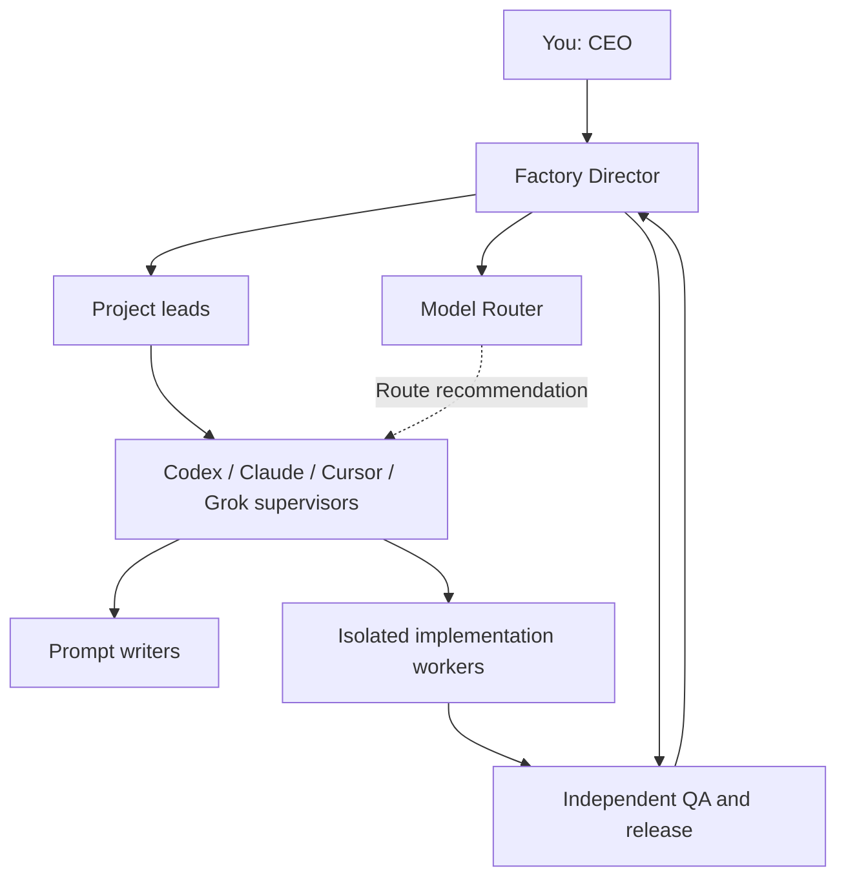
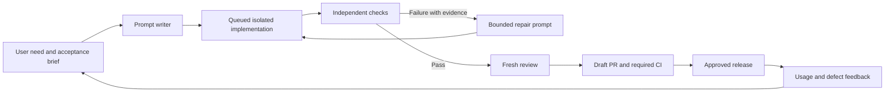

# Overseer software factory blueprint

Research date: 2026-10-18, America/Chicago. Status: architecture and execution plan;
implementation evidence is tracked in `FACTORY_EXECUTION.md`. Vendor capabilities
below were checked against official documentation. Proposed routing and efficiency
claims require local measurement.

## The objective

Produce useful, maintainable product changes with verified behavior, controlled
cost, and recoverable execution. Optimize accepted changes per elapsed hour and
measured dollar, including review and repair. More generated code, agents, or
subscriptions are not success criteria. Product usefulness, usability, reliability,
and escaped defects must be measured alongside delivery speed.

We will use the best tool for each stage, then retain it only if the evidence
justifies its cost and complexity. METR's early-2025 randomized study found a 19%
slowdown in its specific experienced-maintainer setting; that result is not a
ranking of today's models or a universal prediction. It demonstrates why perceived
speed is insufficient. [Study and limitations](https://metr.org/blog/2025-07-10-early-2025-ai-experienced-os-dev-study/).

## Current foundation and gaps

Overseer already has guarded tmux delivery, a durable terminal FIFO, exclusions,
retry limits, tests, and a single project-terminal hub. `coder_optimization`
provides task/review templates and an offline scorecard. These are reusable.

Terminal capture is not authoritative job state. A sent message does not prove
execution; `OVERSEER_DONE` does not prove acceptance. The terminal queue cannot
control manual starts, excluded sessions, nested agents, or provider capacity.
Keep it as a compatibility/operator layer while structured workers are introduced.
Do not close the reptyr donor emulators as part of this migration.

Local discovery found Git, GitHub CLI, Codex, Claude, Cursor, Grok Build, uv, and
pytest on PATH. Codex and Claude report logged-in status; GitHub's user endpoint
responded successfully. These checks do not prove model availability or repository
administration rights. Cursor/Grok sign-in, secure keyring setup, and live model
execution need verification. The installation record already notes Cursor's
missing OS keyring. Docker/Podman, Ruff, mypy, Semgrep, Gitleaks, Trivy, and Temporal
were not on PATH. Tools may exist inside project environments; this was not a
machine-wide package audit. No `.github/workflows` directory was found in the
three inspected roots: Overseer, coder_optimization, and lead-intake.

## Where the requested tools belong

| Tool | Proposed job | Boundary and adoption test |
| --- | --- | --- |
| GitHub | Issues/task briefs, branches, pull requests, required checks, review history, releases | Every accepted change has a revision and evidence. Enforce checks with rulesets; verify plan/repository availability. |
| Cursor | Primary human coding cockpit: explore code, inspect diffs, refine UI, debug, and work interactively with agents | Open the task's isolated workspace, not a second writer on the live checkout. Compare its complete workflow on matched tasks. |
| Cursor Cloud Agents/Automations | Optional managed workers for scheduled maintenance and repository events | One trigger owner per task. Either Cursor owns the run and reports its ID to Overseer, or Overseer dispatches it. Never duplicate the same issue in both systems. |
| Codex | First candidate for structured implementation and review workers | Consume supported JSONL events and validate the patch independently. CLI login is distinct from API billing. |
| Claude Code | Another implementation/review candidate, useful for cross-check experiments | Use headless JSON/streaming output and explicit tool permissions. Do not assume it should always plan or always review. |
| Grok Build | Third coding-worker candidate | Its documented headless/JSON and ACP interfaces are preferable to terminal keystrokes. Authenticate and test a bounded task before routing real work. |
| Grok Bot | Optional persistent research/operations assistant for collecting requirements, monitoring inputs, and preparing task proposals | Keep outside merge/release authority. Its shared account computer requires deliberate access boundaries. Evaluate whether it saves operator time. |
| coder_optimization | Measurement lab and shared engineering playbook | Freeze comparable tasks; preserve failures and actual usage. No model wins by reputation alone. |
| Overseer | Task ownership, state, scheduling, evidence, limits, and operator controls | Own the execution contract; let established tools do editing, CI, and source control. |

Cursor's agent has file, terminal, and browser tools; its local checkpoints are
separate from Git. Its automations support schedules and source-control events.
[Cursor Agent](https://cursor.com/docs/agent/overview),
[Automations](https://cursor.com/docs/cloud-agent/automations).
Codex provides noninteractive JSONL events and structured final output, while its
GitHub review integration supplements normal review checks.
[Codex execution](https://learn.chatgpt.com/docs/non-interactive-mode),
[Codex review](https://learn.chatgpt.com/docs/third-party/github).
Claude provides programmatic structured output and a GitHub Actions integration.
[Claude headless](https://code.claude.com/docs/en/headless),
[Claude Actions](https://code.claude.com/docs/en/github-actions).
Grok Build supports headless output and ACP; Grok Bot is a distinct persistent
assistant product, not merely another name for the CLI.
[Grok Build scripting](https://docs.x.ai/build/cli/headless-scripting),
[Grok Bot](https://docs.x.ai/grok-bot/overview).

## Additional tools in priority order

| Priority | Tool or capability | Why and when |
| --- | --- | --- |
| Now | GitHub Actions plus branch rulesets | Run the same checks locally and in CI; prevent unverified merges. Configure remote enforcement when a target repository exists. |
| Now | Isolated Git worktrees, pinned dependencies, one setup/check command | Reproduce jobs without overwriting another agent's work. A worktree is file isolation, not a security sandbox. |
| Now for Python | Ruff; existing unittest/pytest; add type checking incrementally | Catch inexpensive mechanical defects before model review. Preserve established suites. |
| Next for web apps | Playwright with trace artifacts and accessibility checks | Verify critical user journeys, responsive behavior, error paths, and visual changes. Browser clicking by an agent alone is not regression coverage. |
| Next | Semgrep or GitHub CodeQL; secret scanning; dependency review/Dependabot | Start with one static security scanner plus secrets/dependency checks; tune false positives before expanding. Private-repository features may require paid access. |
| Next for releases | Error monitoring such as Sentry; release IDs and smoke checks | Connect shipped failures to the responsible change and create reproducible repair tasks. Evaluate retention and pricing before adding a service. |
| When executing less-trusted jobs | Rootless containers or disposable VMs | Limit filesystem, network, resources, and secrets. Running as the same local user is not a sandbox. |
| When runs span machines or long approvals | Temporal | Durable orchestration with retry and recovery semantics; defer until a small local runner exposes the actual need. |
| Only if agent graphs need it | LangGraph | Checkpointed agent state; not a mandatory second scheduler alongside Temporal and Overseer. |
| Later | OpenTelemetry | Correlate task, run, provider, CI, and release events when multiple services make debugging difficult. |

[GitHub rulesets](https://docs.github.com/en/repositories/configuring-branches-and-merges-in-your-repository/managing-rulesets/available-rules-for-rulesets),
[Ruff](https://docs.astral.sh/ruff/),
[Playwright traces](https://playwright.dev/docs/trace-viewer),
[Semgrep CI](https://docs.semgrep.dev/semgrep-ci/sample-ci-configs),
[dependency review](https://docs.github.com/en/code-security/concepts/supply-chain-security/dependency-review),
[Temporal](https://docs.temporal.io/ai),
[LangGraph persistence](https://docs.langchain.com/oss/python/langgraph/persistence),
[OpenTelemetry signals](https://opentelemetry.io/docs/concepts/signals/).

Do not purchase five overlapping review bots, install every MCP server, or introduce
Kubernetes to coordinate a single workstation. Trial one tool per missing
capability. MCP exposes tools/context; it does not establish trustworthy output,
permissions, isolation, or durable job ownership by itself.

## The organization and authority

You are the CEO: choose the business outcomes, priorities, budget envelopes, and
material release decisions. The Factory Director turns those decisions into work,
reports evidence, and escalates only decisions outside delegated authority.

| Role | Owns | Cannot delegate away |
| --- | --- | --- |
| CEO (human) | Product vision, priorities, budget, exceptional risk | Final business authority |
| Factory Director | Portfolio execution, dependencies, progress, cross-project coordination | Accountability for evidence and stopping rules |
| Project lead | Scope, architecture, task briefs, acceptance, backlog | Domain requirements and one owner per change |
| Model Router agent | Model/provider/reasoning recommendation for each role and task | Must obey model constraints, budget, capability allowlists, and measured evidence |
| Codex supervisor | Codex workers, credentials readiness, availability, run recovery | Actual dispatch/result reporting |
| Claude supervisor | Claude workers, permissions, usage and failure handling | Actual dispatch/result reporting |
| Cursor supervisor | Interactive workspaces and selected Cloud Agent automations | Prevent duplicate task ownership with other schedulers |
| Grok supervisor | Grok Build workers and separately scoped Grok Bot routines | Keep bot access and coding/release authority distinct |
| Prompt writer | Latest-output review and the next bounded execution prompt | Preserve the task's acceptance criteria |
| Implementation workers | Isolated changes and reproducible evidence | Cannot certify their own product acceptance |
| QA and release lead | Independent checks, consequential review, release/rollback evidence | Cannot accept a change solely on worker claims |

These are responsibility boundaries; they do not require ten always-on model
sessions. Activate a specialist when a task needs it. Managers must not create
unlimited descendants. The initial depth limit is three agent levels below the
human, with one implementation writer per workspace. Increase concurrency only
after isolation and resource accounting work. The director can host project-lead
and supervisor responsibilities initially while keeping their decisions explicit.

The router receives the frozen task, role, risk, required tools/context, permitted
models, recent relevant evaluation results, provider availability, and budget.
It returns a structured recommendation with provider, model, reasoning effort,
reason, evidence, permitted fallback, and stopping condition. A deterministic
policy validator checks the recommendation before dispatch. The router cannot
invent availability, silently change the task, or remove an explicit Astra-only
authorship requirement. Cold-start decisions are labeled provisional; compare
them against the existing baseline. Capacity alone does not establish that a
different model is equivalent or that the user's terminals caused overload.

`factory/routing-policy.json` is the initial policy template. Model allowlists
remain empty until specific models/capabilities and budgets are verified. This
template documents authority; it is not yet an enforced live router. The current
local command runner does not automatically invoke supervisors or nested agents.

CEO reports should fit one screen: delivered outcomes with evidence, work running,
next queued jobs, exact blockers requiring a decision, observed spend/unknowns,
quality failures, and proposed priority changes. Detailed traces remain available.

## The production line workflow

The prompt writer receives the latest output, relevant changed files, actual test
results, and remaining acceptance criteria. It produces one bounded executable
prompt. The worker executes it. A separate verifier runs the frozen acceptance
commands. A reviewer examines consequential changes and their contracts. Do not
let the implementer silently weaken acceptance checks, change the task definition,
or convert a failed run into a pass by declaring completion.

Human ownership remains over the product objective, material scope changes,
sensitive production actions, and final acceptance. Automate routine reversible
steps within the approved task. A draft-only request stays draft-only. Human
approval should occur at meaningful boundaries, not every tool call.

For UI products, acceptance includes a usable journey and visual evidence. For
solver/numerical projects, include reference comparisons and domain invariants.
For integration products, verify real boundaries separately from mocks. A green
unit suite cannot establish product-market fit, numeric correctness, or successful
cross-machine delivery by itself.

## Durable execution contract

Use a local SQLite ledger first. A task records its objective, immutable spec hash,
repository/revision, workspace, author, command/prompt references, permissions,
verification commands, budgets, and requested provider/model. Every attempt gets
its own ID and artifact directory. Record observed provider identity separately.

Target states are `queued -> preparing -> running -> checking -> reviewing ->
ready_for_pr -> accepted`, with explicit `failed`, `blocked_capacity`,
`blocked_auth`, `needs_input`, `cancelled`, and `needs_reconciliation` outcomes.
The initial command runner can implement a smaller subset, documented honestly.

Reserve durably before starting a process. Use worker locks, run IDs, process
identity, and later heartbeats. If the controller dies after dispatch, reconcile
the attempt before retrying. No blanket claim of exactly-once external effects:
use idempotency keys where supported, check the actual remote result otherwise.
Store event timestamps, command exits, logs, check results, revision/diff identity,
and review findings. Keep secrets out of the ledger and sanitize exported logs.

Capacity and quota are different. Back off transient capacity with jitter and a
bounded retry budget. Authentication errors need repair, not repeated model calls.
A quota error waits for its documented reset or approved budget. Ambiguous delivery
requires reconciliation. Start with one provider worker; later add provider/model
pools and one writer lease per repository/worktree. Nested agents must count toward
resource budgets when the adapter can observe/control them. Unknown child activity
must not be reported as globally serialized.

Keep FIFO ordering among eligible tasks and avoid permanently starving unrelated
work behind one unavailable provider. Use only explicitly configured fallback
models that satisfy the project's role requirements. The existing solver's required
Astra prompt authorship must not be silently substituted. GitHub workflow
concurrency has its own queue semantics and is not a replacement for cross-provider
run ownership. [GitHub concurrency](https://docs.github.com/en/actions/how-tos/write-workflows/choose-when-workflows-run/control-workflow-concurrency).

## Loops to build

1. **Implementation loop:** accepted task -> writer -> implementation -> checks.
   On failure, feed exact failing evidence to the writer and repair only that task.
2. **Review loop:** independent findings -> minimal correction -> affected checks ->
   updated review. Do not circulate the same unsupported criticism indefinitely.
3. **Maintenance loop:** dependency/CI failure -> reproduce -> candidate patch ->
   draft PR. Do not merge simply because a bot opened it.
4. **Product loop:** measured user problem -> prioritized hypothesis -> small
   change -> release -> user/defect evidence. Reject output that adds complexity
   without a useful product result.
5. **Factory-improvement loop:** inspect run outcomes in coder_optimization;
   change one routing/prompt/tool variable and compare matched tasks.

Initial policy proposal: at most two repair attempts after the first implementation,
a timeout for every command, a per-task wall-clock cap, and an explicit cost cap
where the provider can enforce one. Stop sooner for scope, permission, unchanged
failure, or unavailable prerequisites. Unknown cost stays null; timeouts alone do
not enforce a provider billing cap. This extends the documented review/repair/
validation pattern, not an endless 'continue' loop.
[OpenAI iterative repair example](https://developers.openai.com/cookbook/examples/codex/build_iterative_repair_loops_with_codex).

## Execution phases and acceptance

| Phase | Deliverable | Exit evidence |
| --- | --- | --- |
| 1: local foundation | Blueprint, Git baseline, setup/check commands, CI definition, SQLite task/run ledger, explicit local worker | Isolated implementation/check fixture passes; failing acceptance remains failed; timeout/crash tests pass; real Overseer validation run recorded; no legacy monitor changes. |
| 2: one AI adapter | Codex structured worker with frozen brief, worktree, writer handoff, event reconciliation, bounded repair | One real bug fixed in a disposable task branch; independent tests pass; forced capacity/auth failure classified; restart does not create duplicate work. |
| 3: GitHub delivery | Explicit issue intake, draft PR, required checks, reviewed merge path | A failing check prevents acceptance; duplicate webhook creates no duplicate task; PR references run evidence. Verify remote permissions and billing first. |
| 4: provider trials | Claude and Grok Build adapters; Cursor worktree workflow; optional Cursor automation worker | Matched tasks with observed identities and all failures retained; choose routes from evidence rather than permanent model stereotypes. |
| 5: product operation | Operator board, pause/resume/cancel, bounded retry controls, previews, releases, rollback and monitoring | One controlled release and rollback drill; blocked work has a precise reason; operator can stop dispatch without losing evidence. |
| 6: scale only proven routines | Multiple resource pools, managed workers or Temporal if warranted | Fault-injection tests and measured throughput gains without worse acceptance or escaped defects. |

Use Overseer as the first low-risk pilot; choose tasks with no desktop or external
side effects. Do not begin with production Windows recovery, security targets,
paid provider benchmarks, or every project simultaneously. Later add one web
project to test UI verification and one domain-heavy project to test correctness.

For initial comparisons, use three representative frozen tasks (bug, bounded
feature, and relevant refactor/UI task), the same starting revisions and acceptance,
and randomized provider order. Start with one run per candidate to test plumbing;
repeat before adopting a default. Reuse the existing optimizer scorecard instead
of creating a competing measurement system. Track end-to-end time, acceptance,
human repair/review time, escaped defects, and provider-reported usage/cost. Report
coverage when metrics are missing. Set gain targets after the baseline exists.

## First implementation backlog

1. Preserve a local Git baseline while excluding profiles, downloads, secrets,
   task evidence, and machine-specific runtime state.
2. Add `scripts/check` and a GitHub Actions check definition. Keep tests isolated
   from the live tmux server.
3. Implement explicit submit/status/inspect/run-one/reconcile commands backed by
   SQLite, with immutable input and no automatic crash retry.
4. Demonstrate both passing and failing independent acceptance in disposable
   workspaces; record an actual Overseer test run.
5. Add supported Codex execution and event validation next; share the existing
   provider capacity gate before unattended provider work is enabled.
6. Connect a chosen GitHub repository and enforce checks. Creating a workflow file
   locally is not proof that GitHub ran it or branch protection is active.
7. Add the operator board after state is trustworthy. Show task, project, owner,
   provider, stage, wait/block reason, attempts, evidence, and available usage.

## Decisions still needed before expansion

Verify target GitHub repository/visibility, account entitlements, safe worker
isolation, and a daily/weekly provider budget. Resolve Cursor credential storage
and Grok authentication. Choose a product outcome and release environment for the
second pilot. These do not prevent the local foundation from being built now.

Detailed installed results and remaining gaps belong in `FACTORY_EXECUTION.md`.
No universal best model or measured efficiency improvement is claimed by this plan.
